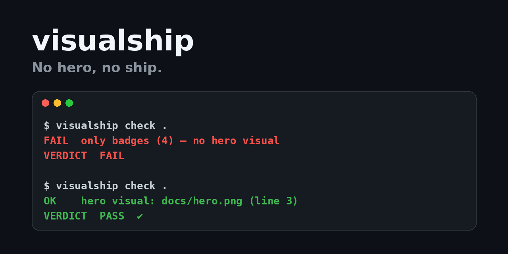

# visualship



**No hero, no ship.** `visualship` is a tiny CLI + agent skill that refuses to ship a public repo until its README shows a real screenshot or GIF above the fold — not a wall of badges.

AI agents now publish repos in minutes. Most land with a generated wall of text, six badges and zero pictures of the thing working. visualship is a one-second gate you (or your agent) run before flipping a repo public.

## Install

```sh
git clone https://github.com/mturac/visualship && node visualship/bin/visualship.js check .
```

Zero dependencies. Node >= 18.

## What it checks

| Verdict | When | Exit |
|---|---|---|
| `FAIL` | README missing, no image, only badges (shields.io, codecov, coveralls, Actions badges), broken local image path, or hero below line 40 | 1 |
| `WARN` | No install one-liner in a code block, or unsourced metric claims (`used by 10,000+`, `#1 on Product Hunt`) | 0 |
| `PASS` | Real hero image above the fold, install line, no invented numbers | 0 |

The last line is always machine-readable: `VERDICT<TAB>PASS|WARN|FAIL`.

## Example

```text
$ node bin/visualship.js check fixtures/fail
FAIL  no image in README — add a screenshot/GIF hero
VERDICT	FAIL

$ node bin/visualship.js check .
OK    hero visual: docs/hero.png (line 3)
VERDICT	PASS
```

## Agent skill

Drop [`skills/visualship/SKILL.md`](skills/visualship/SKILL.md) into your agent's skills folder (Claude Code, Codex, Cursor, …). When asked to ship/publish/open-source a repo, the agent runs the check first and adds a hero visual before going public.

Not a security scanner — pair it with a skill security tool for that.

## License

MIT © Turaç (mturac)
